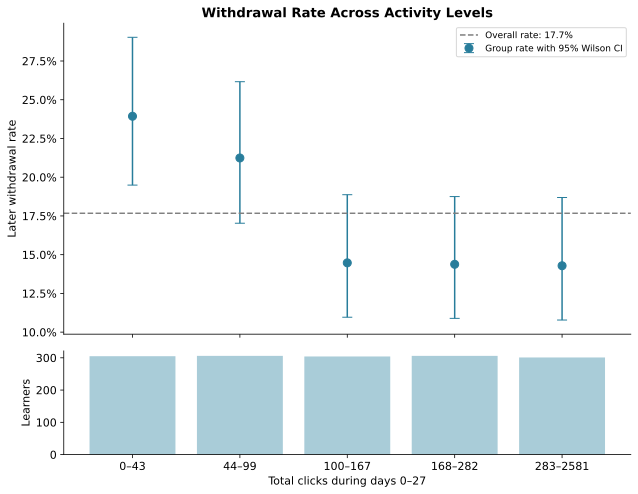
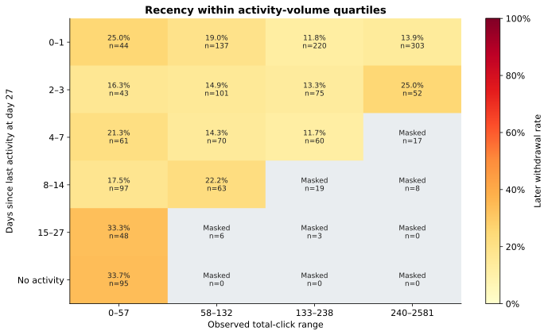
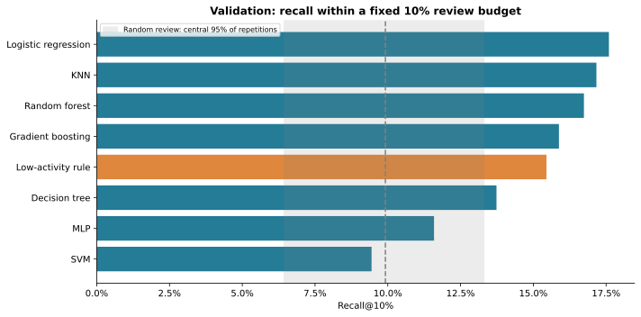
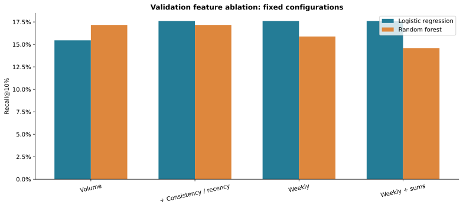

# Early Learning Support

### From early engagement signals to learner-review ranking

**At day 28, if an educator can review only 10% of learners, which method identifies the most learners who later withdraw?**

[Explore the data in Colab](https://colab.research.google.com/github/Junghwan0516/early-learning-support/blob/main/01_data_exploration.ipynb) · [Compare models in Colab](https://colab.research.google.com/github/Junghwan0516/early-learning-support/blob/main/02_model_comparison.ipynb) · [Analysis design](docs/analysis_design.md)

## Why I built this

My work in education motivates an interest in how learning records can support timely outreach. An educator's time is limited, so identifying which learners to review first is a concrete decision problem. I chose this project to connect that educational context with data analysis, reproducible machine learning, and a usable prediction function.

The day-28 cutoff and 10% review capacity are explicit design assumptions. The project uses public historical records and supports human review. Predicting withdrawal does not determine its cause or demonstrate that an intervention will prevent it.

## What is complete

- Raw OULAD reconstruction with source checksum verification and exact value-level agreement with the prepared table.
- Training-cohort exploration with **13 figures**, including uncertainty, distribution overlap, conditional heatmaps, individual profiles, and sensitivity checks.
- Validation comparison of **7 model families × 3 configurations**, a low-activity rule, and 500 random-review repetitions.
- Fixed-configuration feature ablation, ranking curves, error analysis, and paired-bootstrap diagnostics in **6 additional figures**.
- An input-validated batch-ranking command using the frozen validation-selected method.

**Final-test evaluation and service deployment are pending.** Notebook 03 is deliberately gated. Validation results below are development estimates, not production performance.

## Results that changed the direction of the analysis

### Low activity matters, but more clicks are not uniformly better

The lowest click group has a 23.9% later-withdrawal rate, compared with 14.3% in the highest group. The three highest groups have similar rates (14.5%, 14.4%, 14.3%). Both outcome groups show a week-4 decline, so a decline alone is not a withdrawal-specific signal.



### Recency and consistency add questions, not simple rules

The training withdrawal rate is 14.9% for learners active within the last 0–1 days, 33.3% for those last active 15–27 days earlier, and 33.7% for no recorded activity. Intermediate groups are not strictly ordered. Sparse conditional groups and overlapping distributions limit simple conclusions.



## Validation benchmark

Training: **2013B, 1,522 records**. Validation: **2013J, 1,788 records**, including 233 withdrawals. Review budget: `ceil(0.10 × 1,788) = 179`. Learners seen in earlier splits are excluded from later splits.

| Method | Recall@10% | Precision@10% | Average precision |
|---|---:|---:|---:|
| Logistic regression | 17.6% | 22.9% | 0.178 |
| KNN | 17.2% | 22.3% | 0.161 |
| Random forest | 16.7% | 21.8% | 0.170 |
| Gradient boosting | 15.9% | 20.7% | 0.158 |
| Low-activity rule | 15.5% | 20.1% | 0.165 |
| Decision tree | 13.7% | 17.9% | 0.148 |
| MLP | 11.6% | 15.1% | 0.130 |
| SVM | 9.4% | 12.3% | 0.147 |

Each fitted family receives three predeclared configurations. The table shows the selected configuration within each family. Equal configuration counts do not imply equal compute budgets. All settings and warnings are retained in [model_configurations.csv](reports/model_configurations.csv) and [benchmark_protocol.json](reports/benchmark_protocol.json).

**Selected method: Logistic regression, configuration 2.** It captures 41 of 233 withdrawals within 179 reviews, versus 36 for the low-activity rule. The recall difference is **2.15 percentage points**. Its exploratory paired-bootstrap interval is **-0.42 to 4.29 percentage points**, crossing zero. This does not establish a clear improvement; selection uncertainty is not included.



The feature ablation finds that a three-feature logistic model reaches the same Recall@10% as the larger weekly representation. Adding deterministic early/late sums provides no recall gain for that model. This favors asking whether complexity is useful rather than assuming it is.



## Read or run the project

| Notebook | Purpose | Status |
|---|---|---|
| [00_data_preparation.ipynb](00_data_preparation.ipynb) | Download official data, rebuild features, verify split isolation | Executed |
| [01_data_exploration.ipynb](01_data_exploration.ipynb) | Questions, figures, interpretations, sensitivity checks | Executed |
| [02_model_comparison.ipynb](02_model_comparison.ipynb) | Model/feature comparisons, errors, uncertainty | Executed on validation only |
| [03_final_evaluation.ipynb](03_final_evaluation.ipynb) | Evaluate frozen method on 2014J | Prepared; final test not scored |

**Colab:** open a notebook above and run from top to bottom. Bootstrap cells download helper code and the checksum-verified prepared CSV from this repository when missing. Notebook 00 additionally downloads the raw archive. CPU is sufficient. Start a fresh runtime when switching to updated helper code.

**Local:** install `requirements.txt` or use `requirements-tested.txt` with Python 3.12, then open the notebooks with a notebook editor. To regenerate raw features:

```bash
python prepare_data.py --archive data/raw/oulad.zip --output data/rebuilt_features.csv
python -m unittest discover -s tests -v
python predict.py --input examples/learner_features.csv --output outputs/ranked_learners.csv
```

The inference example contains illustrative feature rows. The command fits the frozen method on the original training cohort and ranks the incoming batch. Scores are not calibrated individual probabilities. Batch rank depends on the other records submitted. See [examples/README.md](examples/README.md).

## Data and evaluation boundary

OULAD is historical **UK Open University** data. BBB is an anonymized module code. Each row is a learner-presentation record. The included 5,062 rows precede repeated-learner exclusion and are not 5,062 unique people.

- Observe days **0–27**; predict at the beginning of day **28**.
- Include learners registered by day 0 and not withdrawn before the cutoff.
- Target 1: known withdrawal on or after day 28. Target 0: Fail/Pass/Distinction.
- Missing withdrawal dates and inconsistent outcome records are excluded.
- IDs, outcomes, withdrawal dates, and future activity are excluded from model inputs.
- Fit scaling on training data only. Select by validation Recall@10%, then average precision; document remaining deterministic ties.
- Use a fixed outcome-independent shuffled order to resolve ranking-score ties across methods.
- Reserve **2014J, 1,685 records**, for final evaluation after selection is frozen.

Metadata and transformations: [data/README.md](data/README.md). Full interpretation boundaries and the purpose of every figure: [docs/analysis_design.md](docs/analysis_design.md).

## Limits and next steps

Clicks measure recorded interactions, not understanding or offline learning. One historical module does not establish performance at current Korean or Canadian institutions. Presentation order alone does not prove training outcomes were available at the next prediction date; exact result-availability dates need further checking. Subgroup patterns are descriptive, and validation model selection can be optimistic.

Next: review the frozen method, run the gated final evaluation, and develop a small prediction interface. A separate NLP portfolio proposal is documented in [Project 2: Science Answer Review](docs/second_project_brief.md); it has not been implemented.

## Development

This independent portfolio combines educational problem framing with AI-assisted code drafting and documentation. Code, execution outputs, experiment settings, and limitations are recorded for inspection. The original executed notebook is preserved in [archive/](archive/).

## Data attribution

Kuzilek, J., Hlosta, M., & Zdrahal, Z. (2015). *Open University Learning Analytics dataset*. UCI Machine Learning Repository. https://doi.org/10.24432/C5KK69

Kuzilek, J., Hlosta, M., & Zdrahal, Z. (2017). *Open University Learning Analytics dataset*. Scientific Data, 4, 170171. https://doi.org/10.1038/sdata.2017.171

OULAD and the included transformed feature CSV are [CC BY 4.0](https://creativecommons.org/licenses/by/4.0/). Preserve attribution and identify modifications when redistributing data. The original authors do not endorse this project. The dataset license does not automatically license the project code.
