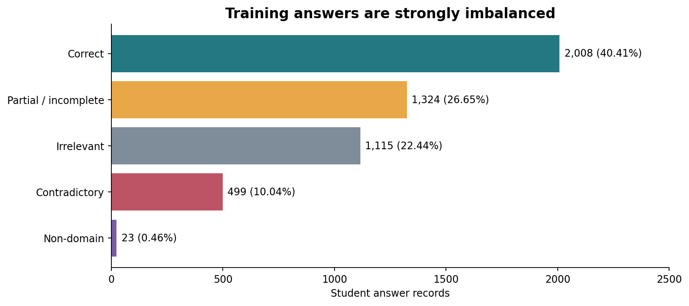
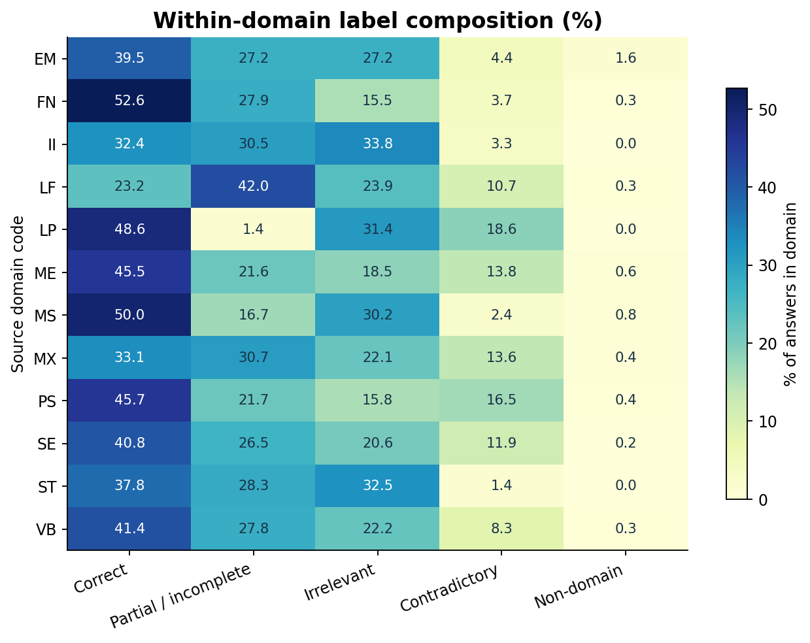
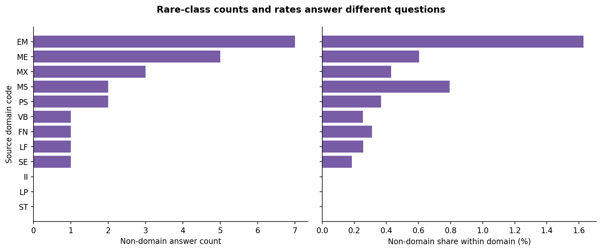
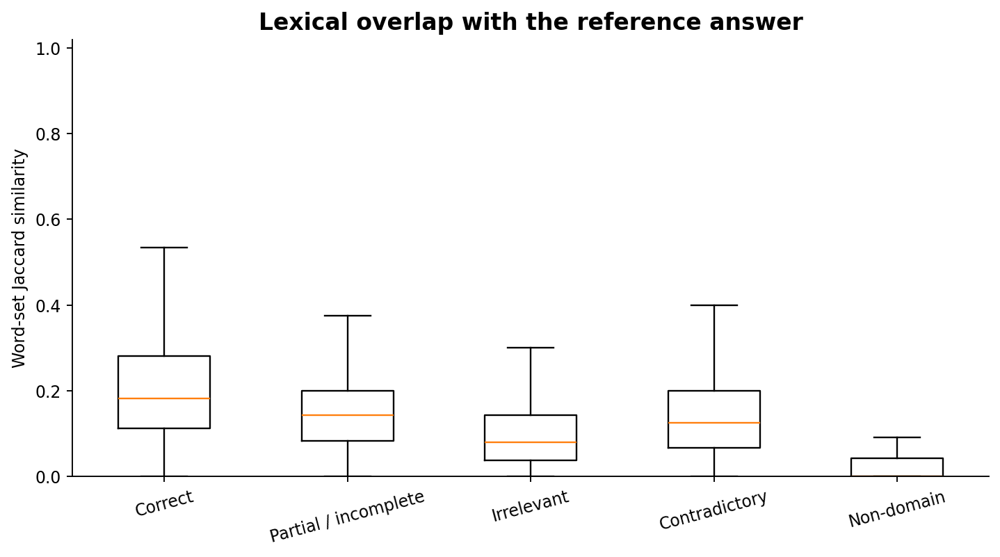
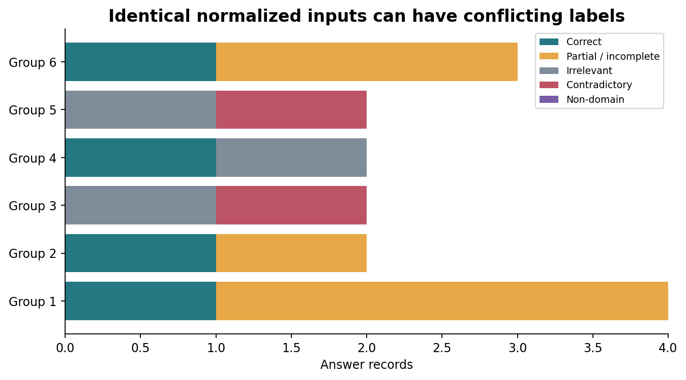
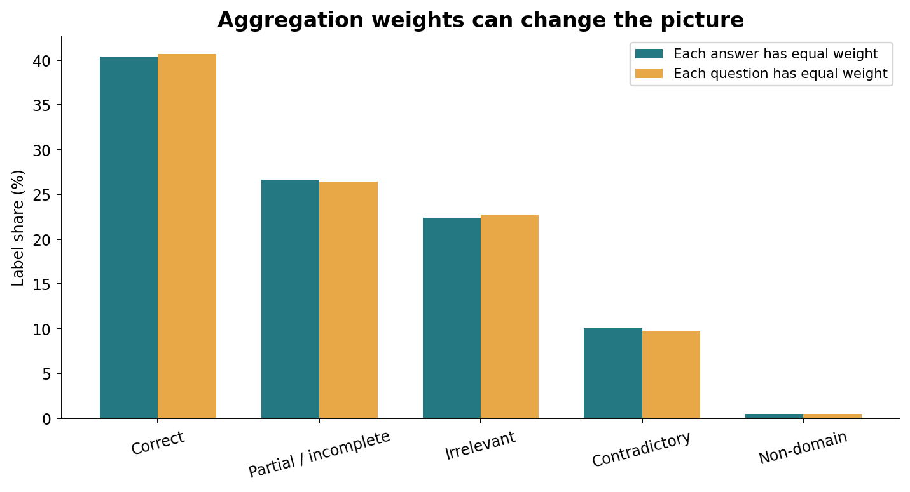

# Science Answer Benchmark — Data Analysis

**What can the data tell us before building a science short-answer classifier?**

An independent education-data portfolio project that investigates class imbalance, question and domain variation, answer language, repeated inputs, and conflicting annotations in SciEntsBank. My work in mathematics and science education motivates the question: what evidence is available in a short response, and what limitations should be understood before using an automated classifier?

**Current scope: data preparation, auditing, exploratory analysis, and reproducible reporting.** Model training and application development are deferred. Every number and figure in this release is computed from the public source data; no prediction accuracy or learning-impact result is claimed.

## Start here

- [Executed dataset-audit notebook](notebooks/00_dataset_audit.ipynb)
- [Executed exploratory-analysis notebook — all 14 figures](notebooks/01_exploratory_analysis.ipynb)
- [Visual report — all 14 figures with interpretation](reports/analysis_report.md)
- [Data files, dictionary, attribution, and license](data/README.md)
- [Analysis methods and limits](METHODS.md)
- [Machine-readable audit summary](reports/tables/audit_summary.json)

[Open the audit in Colab](https://colab.research.google.com/github/Junghwan0516/early-learning-support/blob/main/projects/science-answer-benchmark/notebooks/00_dataset_audit.ipynb) · [Open the EDA in Colab](https://colab.research.google.com/github/Junghwan0516/early-learning-support/blob/main/projects/science-answer-benchmark/notebooks/01_exploratory_analysis.ipynb)

## Questions investigated

1. How imbalanced are the five answer labels?
2. How do domain and question composition change the distribution we observe?
3. What do answer length, reference overlap, and negation markers reveal, and what can they not establish?
4. How common are repeated complete inputs and conflicting labels?
5. Which data properties must inform a later question-grouped evaluation?

## Measured findings

| Finding | Result |
|---|---:|
| Official training answer records | 4,969 |
| Training questions / domain codes | 135 / 12 |
| Correct class | 2,008 records (40.41%) |
| Non-domain class | 23 records (0.46%) |
| Questions / domains with non-domain records | 19 / 9 |
| Median training answer length | 11 whitespace-separated words |
| Unique normalized complete training inputs | 4,826 |
| Repeated complete-input groups / excess rows | 82 / 143 |
| Label-conflicting input groups / records | 6 / 15 |
| UA records with a complete input also present in training | 25 / 540 |

Repeated records can be legitimate independent submissions. Conflicting annotations are flagged, not silently corrected. The official benchmark partitions and original labels are preserved. The 40.41% figure is a **training-data majority-class reference**, not a fitted model or test score.



## Domain variation

Counts and percentages answer different questions. A domain with more responses can contribute more minority-class records without having the highest within-domain minority rate. The complete tables accompany every analysis.





## Text and annotation quality

Answer length and reference-word overlap are descriptive signals. Neither establishes scientific correctness. Duplicate checks compare the full normalized question/reference/response input, rather than response text alone.







See the [full visual report](reports/analysis_report.md) for all 14 figures, including domain counts, answer-length distributions, question sample sizes, label entropy, duplicates, negation markers, and domain overlap differences.

## Included data

| Partition | Answer records | Use in this release |
|---|---:|---|
| [Training CSV](data/processed/train.csv) | 4,969 | Audit and descriptive analysis |
| [Unseen Answers CSV](data/processed/test-unseen-answers.csv) | 540 | Export, inventory, and overlap audit |
| [Unseen Questions CSV](data/processed/test-unseen-questions.csv) | 733 | Export, inventory, and overlap audit |
| [Unseen Domains CSV](data/processed/test-unseen-domains.csv) | 4,562 | Export, inventory, and overlap audit |

Download the [selected original Core XML archive](data/raw/scientsbank_core.zip) to inspect the 331 source XML files. One record is one answer, not one unique learner. UA repeats the training questions, so question counts cannot be summed across partitions. The project contains 10,804 answer records and 196 unique questions in total.

## Reproduce

From this project directory, with Python 3.12:

```bash
python -m pip install -r requirements.txt
python scripts/build_analysis.py
python scripts/verify_release.py
```

To regenerate and execute both notebooks:

```bash
python scripts/prepare_notebooks.py
# If a network-based Jupyter kernel is unavailable:
python scripts/prepare_notebooks.py --in-process
```

The committed notebook outputs were executed in order with IPython in-process execution.

The bundled source subset allows offline data analysis after dependencies are installed. Colab notebooks locate the project automatically and clone this public repository if needed. The pipeline preserves source text and labels, exports all official partitions, validates expected sizes, and rebuilds CSV tables plus PNG figures. [Provenance](data/provenance.json) and [checksums](checksums.sha256) record exactly which data and files were used.

## Interpretation limits and next work

This descriptive study does not measure automatic grading quality, student learning, or teacher time savings. Future model work would need question-grouped development partitions, explicit class supports, duplicate-handling sensitivity analysis, and independently reported UA/UQ/UD results. The rare class and small numbers of evaluation questions/domains limit reliable generalization claims.

The next analysis task is to review the flagged input/label conflicts in context and document a policy before any model development. Original annotations remain unchanged in this release.

## Sources and license

Dataset: Dzikovska et al. (2013), *SemEval-2013 Task 7: The Joint Student Response Analysis and 8th Recognizing Textual Entailment Challenge*. [Paper](https://aclanthology.org/S13-2045/) · [Author-hosted dataset](https://github.com/myrosia/semeval-2013-task7).

Original data, transformed tables, and data-derived figures/reports are distributed under **CC BY-SA 3.0 Unported**. See [the full original license](DATA_LICENSE.txt) and [source attribution](SOURCE_README.md). Dataset authors do not endorse this project. Original analysis scripts in this subproject are MIT licensed; the [code license](LICENSE_CODE) does not replace the dataset license.
