# SciEntsBank — Visual Data Analysis Report

All 14 figures use the official training split (4,969 answer records). These are descriptive analyses; no AI model has been fitted. Each figure is also embedded in the executed exploratory notebook.

[Project overview](../README.md) · [Methods](../METHODS.md) · [Data and attribution](../data/README.md)

## 1. Class imbalance

Correct answers account for 40.41% of training records. A majority-class rule would achieve this training accuracy while missing every other class. The majority/minority count ratio is about 87.3; it is not a model result.

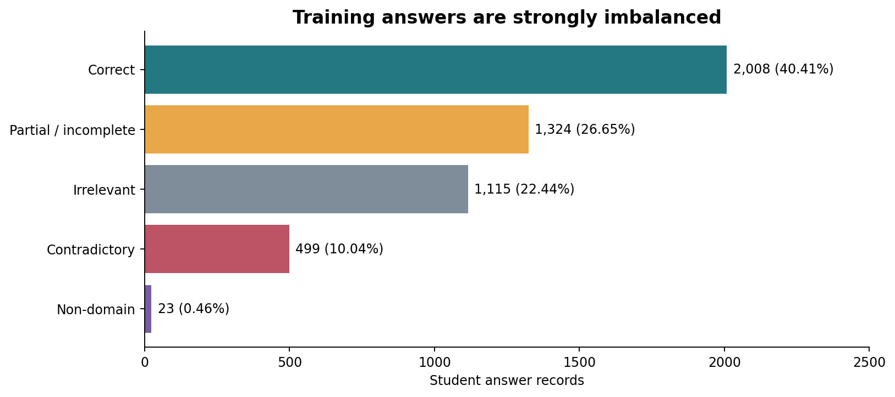

## 2. Domain counts

Each cell is an answer-record count. Domain codes are retained from the source rather than expanded into unverified names.

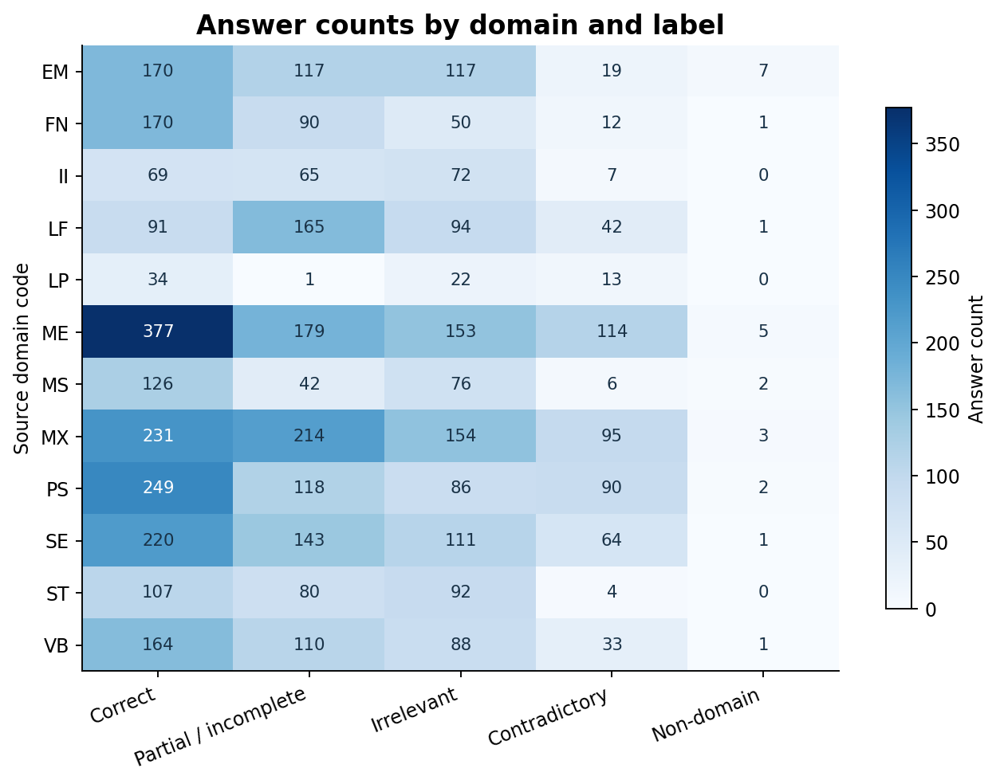

## 3. Within-domain shares

Each row sums to 100%. This removes domain sample-size differences but does not remove uncertainty from small domains. Read it alongside the counts.

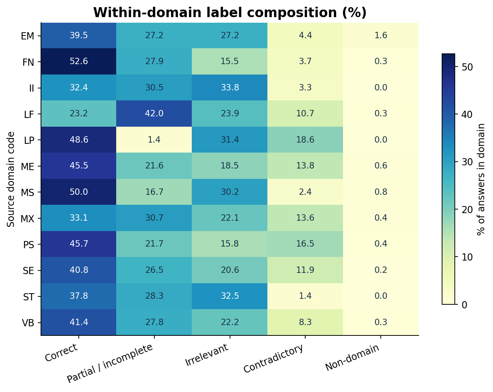

## 4. Answer-length distributions

Whitespace-separated word count is a transparent length measure. Each curve uses its own class denominator; the non-domain curve has only 23 records. The pooled median is 11 words.

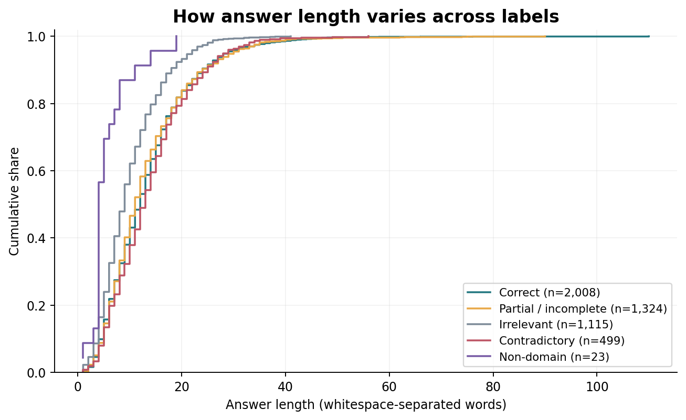

## 5. Length and outliers

The boxes summarize quartiles; points outside the whiskers are retained observations. No record is removed simply because it is long.

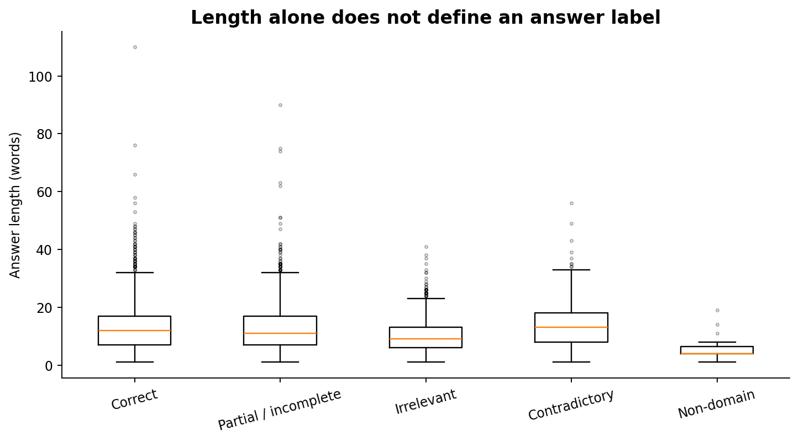

## 6. Reference-answer lexical overlap

Jaccard similarity equals the intersection divided by the union of lower-case word sets. Stop words are retained. Lexical overlap is not a semantic correctness score.

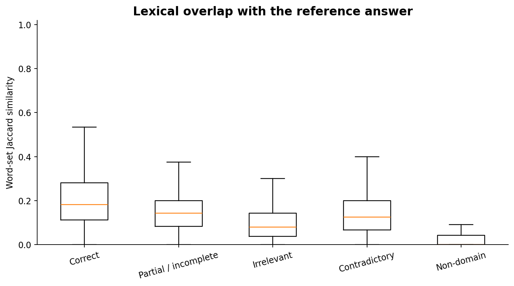

## 7. Unequal question contributions

Questions are ranked by answer count. This is not a time series. Unequal contributions motivate an additional question-weighted analysis.

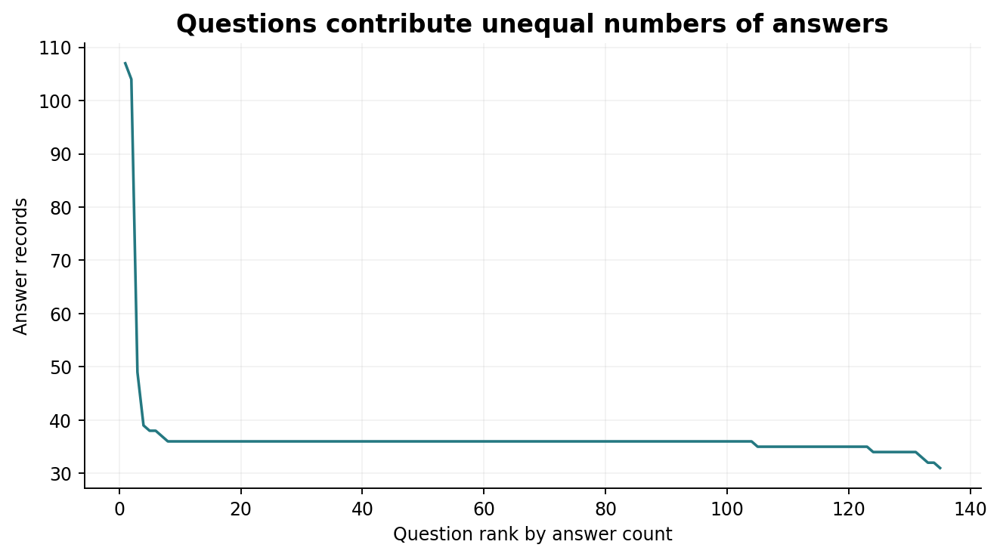

## 8. Question-level label diversity

Each point is a question. Entropy summarizes diversity in the observed labels, not latent student ability or a validated question-difficulty scale. Class share and entropy are derived from the same labels.

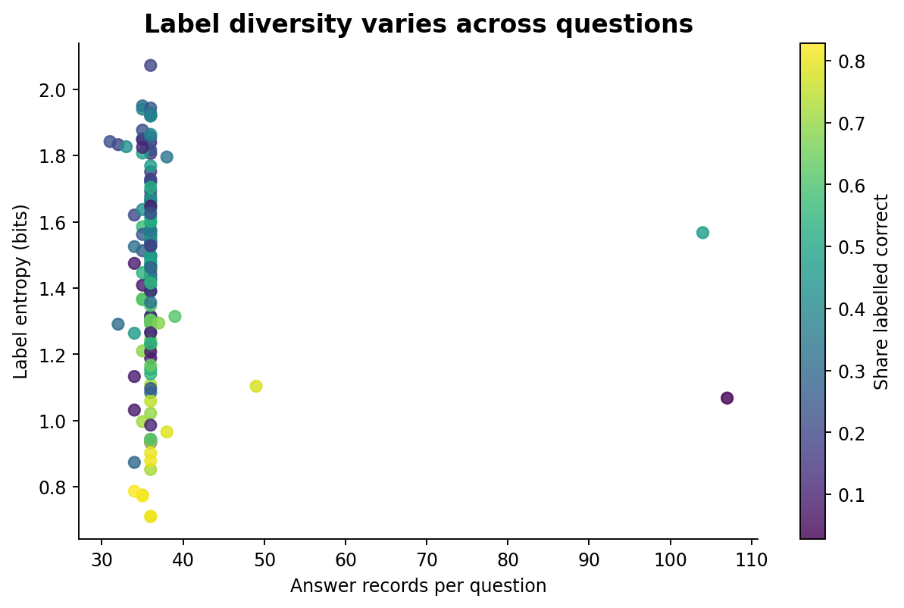

## 9. Minority-class concentration

Counts and within-domain rates use different denominators. Non-domain records occur in 9 of the 12 training domains and 19 of the 135 questions.

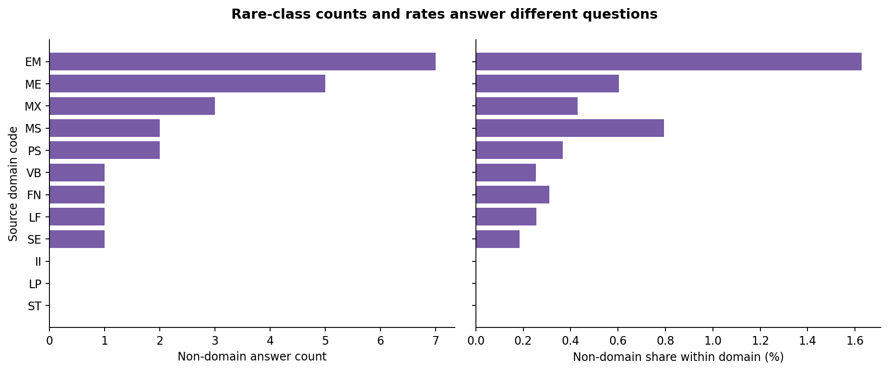

## 10. Repeated inputs

The left panel uses a log count axis so repeated groups remain visible. The right panel separates unique normalized inputs from excess repeated rows. Repetition can reflect independent submissions.

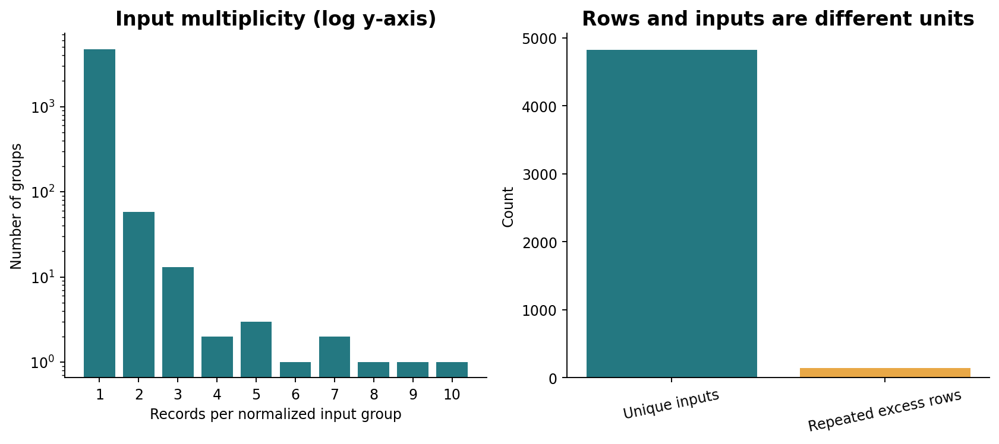

## 11. Conflicting annotations

Six normalized complete-input groups contain more than one label. Inspect the corresponding table before considering any relabelling; the release preserves all original labels.

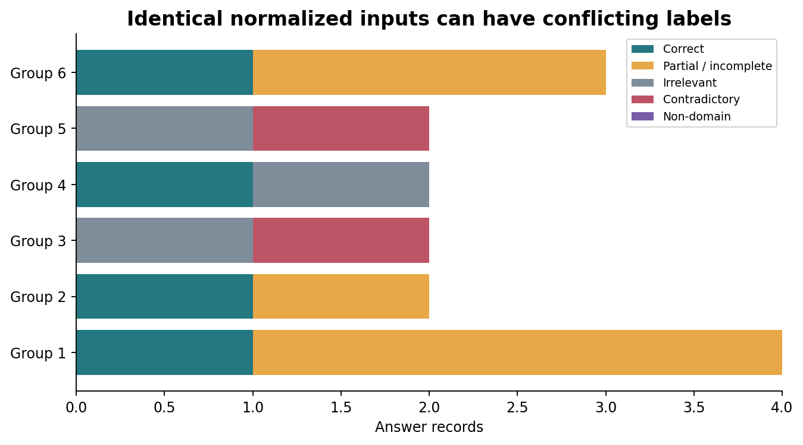

## 12. Negation markers

The listed words and contractions are lexical flags. Scientific contradiction can occur without them, and correct explanations can contain them. This indicator is not a contradiction classifier.

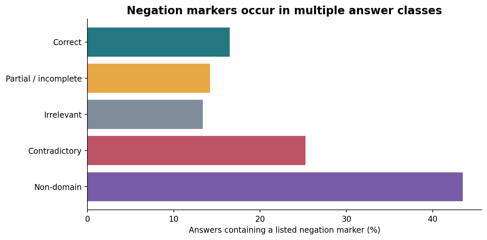

## 13. Aggregation choices

Answer-weighted shares pool all records. Question-weighted shares average within-question shares with equal weight per question. Neither estimates a unique-student distribution.

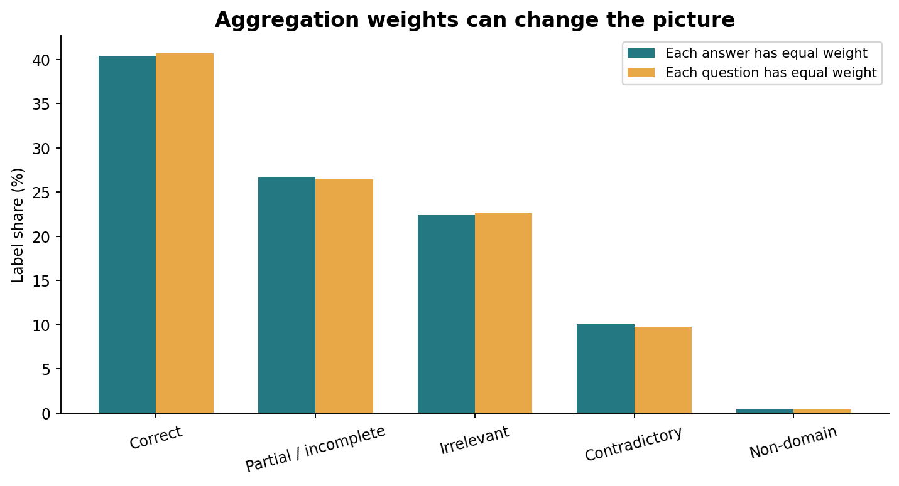

## 14. Overlap across domains

Domain differences may reflect vocabulary, references, questions, or annotation. This descriptive plot cannot identify which mechanism caused them.

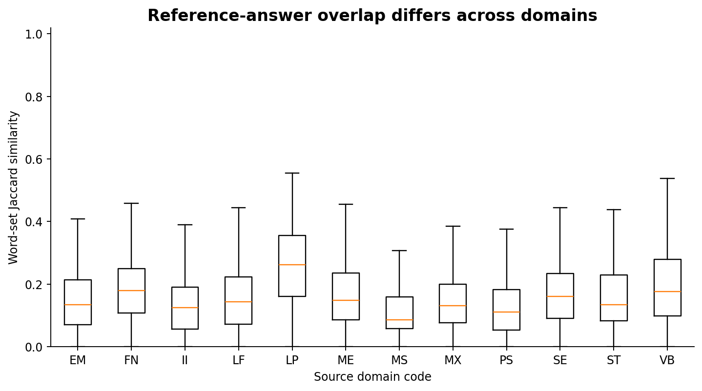

## Data-quality findings

The complete input is the normalized question, reference, and student answer. There are 4,826 unique complete training inputs, 82 repeated groups, and 143 excess records. Six input groups (15 records) contain conflicting labels. Original records and labels remain unchanged. UA has 25 rows with complete inputs also found in training; UQ and UD have no such overlap under this normalization. Official test splits are exported but used only for inventory and overlap checks.

## Interpretation limits

Observed associations do not establish causal effects, learner understanding, grading reliability, or improvements in learning. Source question and domain counts are limited; the rare class has only 23 training records. All source data and data-derived outputs retain CC BY-SA 3.0 attribution to Dzikovska et al. (2013), https://aclanthology.org/S13-2045/. See the full dataset license and data dictionary.
